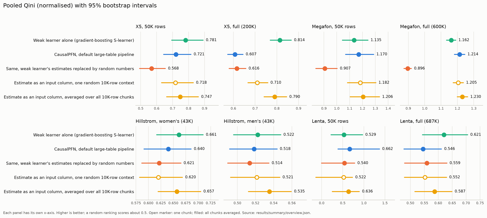

# CausalPFN on large uplift tables: a small experiment

*Lucas Liu, November 22 2026*

The CausalPFN paper notes that on full-size marketing tables the model falls behind simple
baselines (Table 7, most visibly on X5), and Appendix D.6 guesses that the way context rows are
picked for large tables is the reason. I was curious whether that guess is right and spent a
weekend testing it.

## What I found

1. **On large tables, most of the ranking comes from the small gradient-boosting model that
   CausalPFN fits first** (the repo calls it the weak learner), not from the transformer.
   Replace its estimates with random numbers and Megafon drops from 1.214 to 0.896. On full X5
   the pipeline scores 0.607, the same as with random numbers, while the weak learner alone
   scores 0.814.
2. **Showing the model more rows does not help.** All 160K X5 training rows in a single forward
   pass score 0.628.
3. **Giving the weak learner's estimate to the model as an input column works better than
   using it to pick rows.** Against the default pipeline it is clearly better on 3 of 8 tables
   (full X5: 0.607 to 0.790) and worse on none.



Numbers are normalised Qini pooled over 5 folds (higher is better, about 0.5 is random).
Brackets are 95% bootstrap intervals, paired over the same test rows for differences.

## What CausalPFN does with a big table

CausalPFN reads a set of rows with known treatment and outcome (the context) and predicts for
new rows. The context is limited, so the released code does this:

1. fit a gradient-boosting S-learner on the training rows (the weak learner), which gives a
   rough effect estimate per row;
2. sort the rows to predict by that estimate and cut them into batches of about 4K;
3. for each batch, show the model the training rows whose estimates are closest to the batch.

The model never sees the estimate. It only sees the rows that were picked with it. The paper
describes this as a fallback for tables that do not fit in the context; at commit `b7ed2f1` it
runs for every table, and on the 50K samples each batch still gets only about 10K context rows.
That is why the 50K tables show up below as well.

## 1. The ranking mostly comes from the weak learner

Same pipeline, but with the weak learner's estimates replaced by random numbers:

| Table | Weak learner alone | Default pipeline | With random numbers |
|---|---|---|---|
| Megafon full | 1.162 | 1.214 | 0.896 |
| X5 50K | 0.781 | 0.721 | 0.568 |
| X5 full | 0.814 | 0.607 | 0.616 |
| Lenta full | 0.621 | 0.546 | 0.559 |

On Megafon and X5 50K the ranking collapses without the estimates. On full X5 and full Lenta
the default pipeline is no better than with random numbers, and on full X5 it ends up 0.207
below its own weak learner ([0.176, 0.243]). That is the drop in Table 7.

## 2. It is not about context length

Full X5, weak learner not involved:

| What the model sees | Qini |
|---|---|
| One random set of 10K rows | 0.595 |
| 16 random sets of 10K rows, predictions averaged | 0.631 |
| All 160K training rows in one forward pass | 0.628 |

Seeing everything at once is no better than averaging small pieces, and all three are far below
the weak learner (0.814).

## 3. Give the estimate to the model instead of picking rows with it

The change: add the weak learner's estimate as one more input column (cross-fitted for the
context rows, so a row's value never comes from a model that saw its outcome), and pick context
rows at random. I ran two versions:

- **One chunk:** a single random set of 10K rows, one forward pass.
- **All chunks:** split all training rows into random 10K chunks, predict with each, average.

Whether the estimate helps depends on how the rows are picked:

| Context rows | X5 50K, estimate hidden | X5 50K, visible | Megafon 50K, hidden | Megafon 50K, visible |
|---|---|---|---|---|
| Picked by estimate (default) | 0.721 | 0.685 | 1.170 | 1.167 |
| One random chunk | 0.574 | 0.718 | 0.898 | 1.182 |
| All random chunks, averaged | 0.582 | 0.747 | 0.960 | 1.206 |

With random rows it helps a lot; with the default row-picking it does nothing. My guess: rows
picked to have similar estimates make that column nearly constant, so there is nothing to learn
from it.

Against the default pipeline:

| Table | Default pipeline | One chunk | All chunks | All chunks minus default |
|---|---|---|---|---|
| X5 full | 0.607 | 0.710 | 0.790 | +0.183 [+0.143, +0.225] |
| Megafon 50K | 1.170 | 1.182 | 1.206 | +0.035 [+0.010, +0.063] |
| Megafon full | 1.214 | 1.205 | 1.230 | +0.016 [+0.010, +0.022] |

On the other five tables (X5 50K, both Hillstrom campaigns, Lenta 50K and full) the difference
is inside the interval. A few more things worth knowing:

- **One chunk is the cheap version.** It uses 10K rows no matter how big the table is. On full
  Megafon the transformer part takes about 21 s per fold, against 920 s for all chunks and
  6917 s for the default pipeline (shared machines, so rough numbers). All chunks is better than
  one chunk on four tables and never behind.
- **It is stable across tables.** The all-chunks version is never more than 0.034 behind the
  best of {weak learner alone, default pipeline, itself}. The weak learner alone is up to 0.133
  behind and the default pipeline up to 0.207.
- **It does not depend on the exact weak learner.** With scikit-learn's histogram-based
  gradient boosting (same settings, fits in seconds instead of minutes) the picture is the same:
  full X5 0.601 to 0.809, Megafon 50K 1.182 to 1.213.
- I came up with this while looking at X5 results, so X5 is the table it was designed on.
  Megafon, Hillstrom and Lenta were run afterwards with nothing changed.

## What this does not show

- On X5 the weak learner alone is just as good (0.814 against 0.790). The change stops
  CausalPFN from losing there; it does not beat the weak learner.
- Megafon is the only dataset where the transformer clearly adds something on top of the weak
  learner (+0.068 [+0.061, +0.076] on the full table).
- The baselines I ran are the repo's with default settings. The tuned ones in the paper are much
  stronger (in Table 7 the X, DA and T learners are ahead of CausalPFN on full Megafon), so
  nothing here is a claim about beating those.
- One seed for the folds, and Lenta is too noisy to separate anything.

## Setup and code

Same protocol as the repo's `notebooks/qini.ipynb` (5 stratified folds, seed 82718,
`max_context_length=50_000`), CausalPFN at commit `b7ed2f1`, unmodified. As a check, the ratio
of the default pipeline to its weak learner in my runs agrees with the paper's ratio of CausalPFN
to its "S Learner" row within 0.001 on all six X5, Megafon and Hillstrom tables (full X5: 0.746
and 0.746), though not on the two Lenta tables. That makes me think the S Learner row is this
same gradient-boosting model.

```bash
git clone https://github.com/vdblm/CausalPFN && (cd CausalPFN && git checkout b7ed2f1 && pip install -e ".[dev]")
python src/run_qini.py --dataset x5 --stage data
python src/run_qini.py --dataset x5 --stage weak --n-jobs 6
python src/run_qini.py --dataset x5 --stage run --methods weak,cpfn_default,cpfn_placebo,cpfn_K1_B10k_taufeat,cpfn_A_B10k_taufeat
python src/overview.py && python src/make_figure.py
```

Every number above is in `results/summary/`. [`extra/details.md`](extra/details.md) has the
rest: datasets, the other checks I ran (a plain average of the two rankings, cross-fitting
alone), baselines, timings, and what the names in the code and JSON files mean.
The per-fold predictions of every run are attached to the release as `predictions.zip`; unzipped
into `results/qini/` they let you rerun the summary scripts without a GPU.
