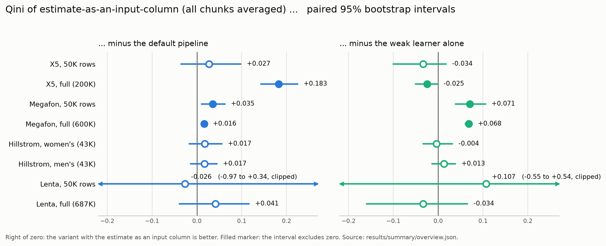

# Details

Everything that did not fit on the main page. Numbers are normalised Qini pooled over 5 folds
unless stated; brackets are 95% bootstrap intervals, paired for differences.

## Datasets

| Dataset | Rows | Columns | Treated | Outcome rate | Average effect | Tables |
|---|---|---|---|---|---|---|
| X5 (Retail Hero) | 200,039 | 6 | 50.0% | 62.0% | 0.033 | 50K sample, full |
| Megafon | 600,000 | 50 | 50.1% | 20.4% | 0.050 | 50K sample, full |
| Lenta | 687,029 | 193 | 75.1% | 10.8% | 0.008 | 50K sample, full |
| Hillstrom, women's campaign | 42,693 | 10 | 50.1% | 12.9% | 0.045 | full |
| Hillstrom, men's campaign | 42,613 | 10 | 50.0% | 14.4% | 0.077 | full |

80% of a table is context, 20% is predicted, five times. Data come from the repo's own dataset
classes (`X5Dataset`, `MegafonDataset`, `LentaDataset`, `HillstromDataset` with outcome `visit`
and control arm `No E-Mail`), and Qini is the repo's `get_qini_curve` formula on the five folds
pooled, as in `notebooks/qini.ipynb`. Chunk size (10K) and "use all chunks"
were fixed before looking at test folds. `src/strategies.py` re-implements the default pipeline
with extra bookkeeping; its output is identical to the original (`results/smoke_test.json`).

## Check against the paper

The paper (arXiv 2506.07918v2, Tables 2 and 7) normalises each column by its best method, so only
ratios of rows can be compared. Default pipeline divided by weak learner in my runs, against
CausalPFN divided by "S Learner" in the paper:

| Table | Here | Paper |
|---|---|---|
| X5 50K | 0.9225 | 0.922 |
| X5 full | 0.7455 | 0.746 |
| Megafon 50K | 1.0312 | 1.031 |
| Megafon full | 1.0446 | 1.045 |
| Hillstrom, men's (paper's Hill(1)) | 0.9925 | 0.992 |
| Hillstrom, women's (paper's Hill(2)) | 0.9677 | 0.968 |
| Lenta 50K | 1.25 | 1.536 |
| Lenta full | 0.879 | 0.947 |

Six of eight agree within rounding. Lenta does not; it is the wide table (193 columns, reduced
by SVD before anything else) and the one where the weak learner's output is mostly ties, so I
would not read much into either Lenta number. I do not know which code produced the paper's
S Learner row; the repo's `SLearnerBaseline(hpo=False)` is a random forest and scores much lower
here.

One more thing I noticed: the paper describes the row-picking as a fallback for tables that do
not fit in the context. At commit `b7ed2f1`, `_predict_cepo` always uses it. On the 50K samples
(40K training rows, `max_context_length=50_000`) each batch of about 4K queries gets roughly 10K
context rows.

## All eight tables

| Table | Weak learner alone | Default pipeline | With random numbers | One chunk + estimate | All chunks + estimate | All chunks minus default |
|---|---|---|---|---|---|---|
| X5 50K | 0.781 | 0.721 | 0.568 | 0.718 | 0.747 | +0.027 [-0.036, +0.098] |
| X5 full | 0.814 | 0.607 | 0.616 | 0.710 | 0.790 | +0.183 [+0.143, +0.225] |
| Megafon 50K | 1.135 | 1.170 | 0.907 | 1.182 | 1.206 | +0.035 [+0.010, +0.063] |
| Megafon full | 1.162 | 1.214 | 0.896 | 1.205 | 1.230 | +0.016 [+0.010, +0.022] |
| Hillstrom, women's | 0.661 | 0.640 | 0.621 | 0.620 | 0.657 | +0.017 [-0.017, +0.056] |
| Hillstrom, men's | 0.522 | 0.518 | 0.514 | 0.521 | 0.535 | +0.017 [-0.014, +0.045] |
| Lenta 50K | 0.529 | 0.662 | 0.540 | 0.522 | 0.636 | -0.026 [-0.969, +0.344] |
| Lenta full | 0.621 | 0.546 | 0.559 | 0.552 | 0.587 | +0.041 [-0.039, +0.117] |

Default minus random numbers: Megafon full +0.317 [+0.299, +0.336], Megafon 50K +0.263
[+0.207, +0.332], X5 50K +0.152 [+0.063, +0.265], X5 full -0.009 [-0.049, +0.038], Lenta full
-0.013 [-0.117, +0.085]. On Lenta 50K the weak learner returns one constant value in four of
five folds, so that row says very little.

## Distance to the best option on each table

| Table | Weak learner alone | Default pipeline | All chunks + estimate |
|---|---|---|---|
| X5 50K | 0 | -0.060 | -0.034 |
| X5 full | 0 | -0.207 | -0.025 |
| Megafon 50K | -0.071 | -0.035 | 0 |
| Megafon full | -0.068 | -0.016 | 0 |
| Hillstrom, women's | 0 | -0.021 | -0.004 |
| Hillstrom, men's | -0.013 | -0.017 | 0 |
| Lenta 50K | -0.133 | 0 | -0.026 |
| Lenta full | 0 | -0.075 | -0.034 |
| Worst case | -0.133 | -0.207 | -0.034 |

The one place the all-chunks version is measurably behind is full X5, 0.025 below the weak
learner ([-0.051, -0.001]).

## Other checks

**A plain average of the two rankings.** Mean of the z-scores of the weak learner's estimate and
the default pipeline's output, built from the saved predictions. On X5 it does as well as the
new variant (full: 0.793 against 0.790). On Megafon it does not: 1.200 on the full table, below
the default pipeline (1.214) and below the new variant (1.230, +0.030 [+0.024, +0.036]).

**Cross-fitting alone.** The default pipeline with cross-fitted estimates changes nothing on X5
(0.600 against 0.607) and gains a little on Megafon 50K (1.183 against 1.170). The new variant
is 0.022 above that, with an interval that includes zero ([-0.004, +0.048]).

**Default row-picking with the estimate also visible.** No gain on any of five tables
(differences between -0.036 and +0.004).

**More context without the estimate.** Full X5: 4 random sets of 40K rows averaged give 0.629,
4K chunks give 0.635, 10K chunks 0.631, everything at once 0.628. On Megafon 50K, 4K chunks
(1.039) were better than 10K chunks (0.960).

**A faster weak learner.** Same S-learner with scikit-learn's `HistGradientBoostingRegressor`
(same number of trees, depth, leaf size, seed). One fit on full Megafon takes about 5 s instead
of about 2800 s.

| Table | Weak learner | Weak learner alone | Default pipeline | All chunks + estimate |
|---|---|---|---|---|
| X5 full | original | 0.814 | 0.607 | 0.790 |
| | fast | 0.813 | 0.601 | 0.809 |
| Megafon 50K | original | 1.135 | 1.170 | 1.206 |
| | fast | 1.145 | 1.182 | 1.213 |
| X5 50K | original | 0.781 | 0.721 | 0.747 |
| | fast | 0.767 | 0.744 | 0.732 |

With the fast one the new variant is +0.208 [+0.172, +0.257] above the default pipeline on full
X5 and level with the weak learner (-0.004 [-0.029, +0.019]); on Megafon 50K it is +0.031
[+0.004, +0.058] above the default. Hillstrom is unchanged.
On full Megafon I only ran two of the five folds with the fast weak learner, and not the default
pipeline (about two GPU-hours per fold): weak learner alone 1.167, one chunk 1.219, all chunks
1.239, against 1.160, 1.214 and 1.235 with the original weak learner on the same two folds.

**Synthetic data with known effects.** On the paper's polynomial benchmark CausalPFN was
roughly three times more accurate than the S, T, X and DA learners at every size I tried (PEHE
0.25 against 0.86 or more at 50K rows, 30 tables), and how the context was built made little
difference. See `figures/poly_pehe_vs_n.png` in this folder.

## Baselines

The repo's S / T / X / DA learners with default settings (`hpo=False`):

| Table | S | T | X | DA | Weak learner | Default pipeline | All chunks + estimate |
|---|---|---|---|---|---|---|---|
| X5 full | 0.590 | 0.645 | 0.800 | 0.816 | 0.814 | 0.607 | 0.790 |
| Megafon full | 0.873 | 0.900 | 0.887 | 0.824 | 1.162 | 1.214 | 1.230 |
| Lenta full | 0.497 | 0.498 | 0.415 | 0.529 | 0.621 | 0.546 | 0.587 |

On X5 the X and DA learners are as good as the weak learner. On Megafon everything that
combines CausalPFN with the estimate is far ahead of these four, but these are default-setting
random forests. The paper's baselines are tuned and much stronger there: in its Table 7 the DA,
X and T learners score 1.000, 0.997 and 0.987 on full Megafon against 0.954 for CausalPFN. So
this table is not a comparison with the paper's baselines.

A note on ties: the S learner predicts exactly zero for about 65% of X5 rows (and for every row
on Lenta 50K), and the weak learner is constant on most Lenta 50K folds. Qini then depends on
how tied rows are ordered, so those particular values can move by a few hundredths.

## Timings

Seconds per fold: transformer part + weak-learner fits. The new variant needs six fits (one on
all rows, five for cross-fitting), the default needs one. The six are independent and I ran
them in parallel; the table shows their sum.

| Table | Default pipeline | One chunk + estimate | All chunks + estimate |
|---|---|---|---|
| X5 full | 91 + 49 | 18 + 228 | 274 + 228 |
| Megafon 50K | 543 + 171 | 2 + 840 | 9 + 840 |
| Megafon full | 6917 + 2783 | 21 + 13421 | 920 + 13421 |
| X5 full, fast weak learner | 65 + 1 | 7 + 4 | 103 + 4 |
| Megafon 50K, fast weak learner | 11 + 1 | 3 + 3 | 9 + 3 |

Measured on shared machines, so these are orders of magnitude. With the repo's weak learner the
fits dominate on large tables; with the fast one that cost goes away. One thing I did not look
into: the default pipeline's transformer part is far slower on Megafon than on X5 at the same
size, and it became much faster when the weak learner changed (543 s to 11 s on Megafon 50K).

## Things I would try next

- How many chunks are actually needed, and whether 4K chunks do as well with the estimate
  visible.
- Whether a prior that includes a cheap per-table estimate as a column would let the model use
  it better than it does out of the box.

## Names in the code and JSON files

| Name | What it is |
|---|---|
| `weak` | weak learner alone |
| `cpfn_default` | default large-table pipeline |
| `cpfn_placebo` | default pipeline, estimates replaced by random numbers |
| `cpfn_xfit` | default pipeline, cross-fitted estimates |
| `cpfn_K1_B10k`, `cpfn_A_B10k` | one random 10K chunk / all 10K chunks averaged, estimate not shown |
| `cpfn_K1_B10k_taufeat`, `cpfn_A_B10k_taufeat` | the same with the estimate as an input column |
| `cpfn_default_taufeat` | default row-picking with the estimate also visible |
| `cpfn_full` | all training rows in one context |
| `S`, `T`, `X`, `DA` | the repo's baselines |
| tables ending in `_hgb` | runs with the fast weak learner |

| File | What is in it |
|---|---|
| `results/summary/overview.json` | Qini, intervals and paired differences for the eight tables |
| `results/summary/grid_<table>.json` | all pairwise differences between methods |
| `results/summary/blend_<table>.json` | the plain-average check |
| `results/summary/stratifier_<table>.json` | original against fast weak learner |
| `results/summary/qini_<table>.json` | every method run on a table, baselines included |
| `results/summary/timing.json` | seconds per fold |
| `results/summary/poly.json` | synthetic benchmark |
| `extra/all_methods.md` | the same as one long table per dataset, including variants that did not work |
